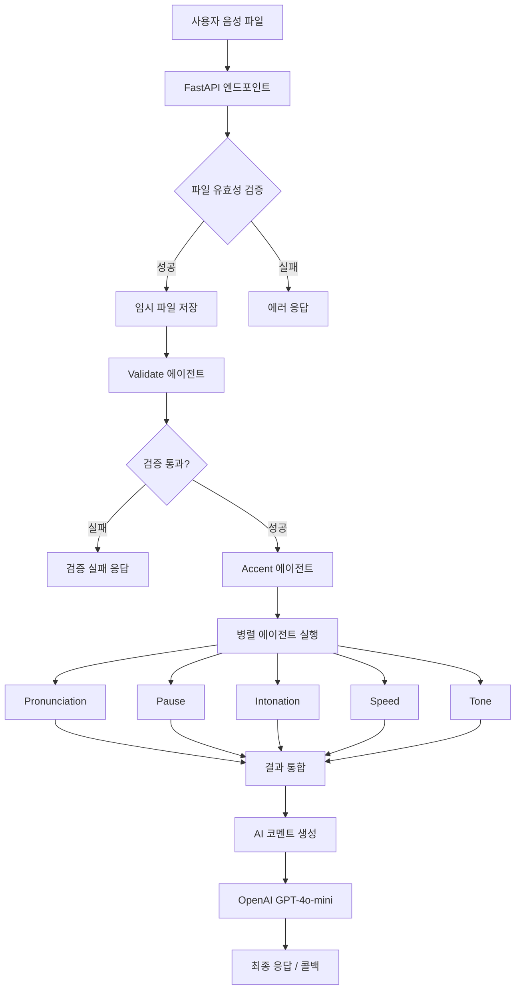

# 🎙️ CrewVoice Evaluation API

> AI 기반 항공사 승무원 기내 안내방송 음성 평가 시스템

[](https://fastapi.tiangolo.com)
[](https://www.python.org)
[](https://azure.microsoft.com/ko-kr/services/cognitive-services/)
[](https://openai.com)
[](https://www.docker.com/)

## 📋 목차

- [개요](#-개요)
- [주요 기능](#-주요-기능)
- [시스템 아키텍처](#-시스템-아키텍처)
- [기술 스택](#-기술-스택)
- [시작하기](#-시작하기)
- [API 엔드포인트](#-api-엔드포인트)
- [프로젝트 구조](#-프로젝트-구조)
- [분석 에이전트](#-분석-에이전트)
- [환경 변수 설정](#-환경-변수-설정)
- [Docker 배포](#-docker-배포)
- [성능 최적화](#-성능-최적화)

---

## 🎯 개요

CrewVoice Evaluation API는 **항공사 승무원의 기내 안내방송을 AI로 평가하는 FastAPI 기반 음성 분석 시스템**입니다. 7개의 독립적인 분석 에이전트가 음성의 다양한 측면을 정밀하게 평가하고, OpenAI GPT-4o-mini를 활용하여 실용적인 피드백을 제공합니다.

### 핵심 가치

- 🎓 **교육 효과성**: 객관적이고 구체적인 평가로 승무원 교육 품질 향상
- ⚡ **빠른 분석**: 병렬 처리를 통한 30-60초 내 분석 완료
- 🤖 **AI 피드백**: 자연스럽고 실천 가능한 개선 방안 제시
- 🌐 **다국어 지원**: 한국어(ko-KR), 영어(en-US) 지원
- 🔄 **마이크로서비스**: Spring Boot 백엔드와 비동기 연동

---

## ✨ 주요 기능

### 1. 7가지 음성 평가 지표

| 평가 항목 | 설명 | 기술 스택 |
|---------|------|----------|
| **검증 (Validate)** | 스크립트 정확도 검증 | Azure Pronunciation Assessment |
| **발음 (Pronunciation)** | 발음 정확도 평가 | Azure Speech Recognition |
| **강조 (Accent)** | 음높이 변화 및 에너지 분석 | Parselmouth + librosa |
| **휴지 (Pause)** | 쉼의 위치와 길이 평가 | 시간 기반 분석 + 문법 분석 |
| **억양 (Intonation)** | 음높이 패턴 분석 | Parselmouth + Baseline 비교 |
| **속도 (Speed)** | 발화 속도 측정 | librosa + 음절 계산 |
| **톤 (Tone)** | 명료도, 안정성, 밝기 평가 | Parselmouth + librosa |

### 2. AI 기반 피드백 생성

- **OpenAI GPT-4o-mini** 활용
- 7가지 측면에 대한 상세한 평가
- 개선 우선순위 및 실천 방법 제시
- 마크다운 없는 순수 텍스트 형식

### 3. 병렬 처리 아키텍처

```
Validate → Accent → [Pronunciation + Pause + Intonation + Speed + Tone] (병렬)
   ↓         ↓                          ↓
Azure 데이터 공유 → API 중복 호출 방지 (비용 절감)
```

### 4. 비동기 백그라운드 처리

- **Fire-and-Forget 패턴**: 즉시 응답 반환, 백그라운드에서 분석
- **콜백 시스템**: 분석 완료 후 Spring Boot에 결과 전송
- **독립 실행**: 여러 요청 동시 처리 가능

---

## 🏗️ 시스템 아키텍처



---

## 🛠️ 기술 스택

### Backend Framework
- **FastAPI** 0.115.5 - 고성능 비동기 웹 프레임워크
- **Uvicorn** 0.32.1 - ASGI 서버
- **Pydantic** 2.10.3 - 데이터 검증 및 직렬화

### 음성 분석
- **Azure Cognitive Services** - Speech Recognition & Pronunciation Assessment
- **librosa** 0.10.0+ - 음성 신호 처리 및 특징 추출
- **parselmouth** 0.4.3+ - Praat 인터페이스 (F0 피치 분석)
- **soundfile** - 오디오 파일 I/O
- **scipy** - 고급 신호 처리

### NLP & AI
- **OpenAI API** 1.0.0+ - GPT-4o-mini를 통한 피드백 생성
- **KoNLPy** 0.6.0+ - 한국어 형태소 분석 (Okt)
- **NLTK** 3.8.0+ - 영어 품사 태깅

### DevOps
- **Docker** - 컨테이너화
- **uv** - 초고속 Python 패키지 관리자

---

## 🚀 시작하기

### 1. 사전 요구사항

- Python 3.12+
- Java 11+ (KoNLPy Okt 형태소 분석기 필요)
- ffmpeg (오디오 파일 변환)

**ffmpeg 설치**:
```bash
# Ubuntu/Debian
sudo apt-get install ffmpeg

# macOS
brew install ffmpeg

# Windows (Chocolatey)
choco install ffmpeg
```

### 2. 설치

```bash
# 저장소 클론
git clone https://github.com/your-org/crewvoice-fastapi.git
cd crewvoice-fastapi

# uv 패키지 관리자 설치 (권장)
curl -LsSf https://astral.sh/uv/install.sh | sh

# 의존성 설치
uv sync

# 또는 pip 사용
pip install -r requirements.txt
```

### 3. 환경 변수 설정

`.env` 파일 생성:

```bash
cp .env.example .env
```

필수 환경 변수 설정:

```bash
# Azure Speech API
AZURE_SPEECH_KEY=your_azure_key_here
AZURE_SPEECH_REGION=koreacentral

# OpenAI API
OPENAI_API_KEY=your_openai_key_here

# Spring Boot 콜백 인증 (선택)
CALLBACK_API_KEY=your_callback_key_here

# 디버그 모드 (개발 환경에서만 true)
DEBUG_SAVE_AUDIO=false
```

### 4. NLTK 데이터 다운로드

```bash
python -c "import nltk; nltk.download('averaged_perceptron_tagger_eng')"
```

### 5. 실행

**개발 모드**:
```bash
uv run uvicorn app.main:app --reload --host 0.0.0.0 --port 8000
```

**프로덕션 모드**:
```bash
uvicorn app.main:app --host 0.0.0.0 --port 8000 --workers 4
```

서버 실행 확인:
```bash
curl http://localhost:8000/health
# {"status":"ok"}
```

API 문서 확인:
- Swagger UI: http://localhost:8000/docs
- ReDoc: http://localhost:8000/redoc

---

## 📡 API 엔드포인트

### 🔍 Health Check

```http
GET /health
```

**응답**:
```json
{
  "status": "ok"
}
```

---

### 🎤 음성 평가 API (즉시 응답)

```http
POST /api/v1/evaluate
Content-Type: multipart/form-data
```

**요청 본문**:
```
audio_file: (파일) WAV, MP3, M4A 형식
script_id: (int) 스크립트 ID
user_id: (str) 사용자 ID
reference_text: (str) 참조 텍스트 (스크립트)
language_code: (str) 언어 코드 (ko-KR 또는 en-US)
```

**응답**:
```json
{
  "score_pronunciation": 85.0,
  "score_pause": 80.5,
  "score_intonation": 82.0,
  "score_tone": 78.5,
  "score_speed": 88.0,
  "score_accent": 81.0,
  "feedback_summary": "전반적으로 우수한 발음을 보였습니다. 억양 조절과 액센트 개선이 필요합니다.",
  "eval_id": "eval-user123-script1"
}
```

---

### 🧪 음성 분석 테스트 API (독립 실행)

> **참고**: 이 API는 Spring Boot와 연동 없이 음성 분석 로직을 테스트하기 위한 독립적인 엔드포인트입니다.

```http
POST /api/v1/analysis/submit/test
Content-Type: multipart/form-data
```

**요청 본문**:
```
file: (파일) 음성 파일
user_id: (int) 사용자 ID
evaluation_id: (int) 평가 세션 ID
step: (str) 평가 단계 (STEP2, STEP3 등)
question_index: (int) 문제 번호
language: (str) 언어 (kor 또는 eng)
```

**응답** (즉시):
```json
{
  "code": 200,
  "message": "제출 성공",
  "data": {
    "submission_id": 105
  }
}
```

**특징**:
- Spring Boot 콜백 없이 독립적으로 동작
- 음성 분석 로직 테스트 및 디버깅용
- 백그라운드에서 비동기로 분석 처리

---

### 🔗 Spring Boot 연동 API (콜백 방식)

```http
POST /api/evaluate
Content-Type: application/json
```

**요청 본문**:
```json
{
  "taskId": "550e8400-e29b-41d4-a716-446655440000",
  "audioUrl": "https://s3.amazonaws.com/bucket/audio.wav?...",
  "script": "안녕하세요 승객 여러분, 잠시 후 이륙하겠습니다.",
  "language": "ko-KR",
  "callbackUrl": "https://server.crewvoice.cloud/api/v1/evaluations/callback",
  "weights": {
    "weight_clarity": 0.4,
    "weight_stability": 0.3,
    "weight_brightness": 0.2,
    "weight_pitch_position": 0.1
  }
}
```

**응답** (즉시):
```json
{
  "message": "Request received",
  "task_id": "550e8400-e29b-41d4-a716-446655440000"
}
```

**콜백 (완료 후)**:
```json
{
  "task_id": "550e8400-e29b-41d4-a716-446655440000",
  "status": "completed",
  "scores": {
    "score_pronunciation": 85.50,
    "score_pause": 90.00,
    "score_intonation": 78.50,
    "score_tone": 82.00,
    "score_speed": 88.00,
    "score_accent": 75.00
  },
  "feedback_summary": "전반적으로 우수한 발음을 보였습니다..."
}
```

---

## 📁 프로젝트 구조

```
FastApi/
├── app/
│   ├── main.py                      # FastAPI 애플리케이션 엔트리포인트
│   ├── apis/                        # API 라우터
│   │   ├── v1/
│   │   │   ├── router_evaluate.py   # 음성 평가 엔드포인트
│   │   │   └── router_submission.py # 음성 제출 엔드포인트
│   │   └── router_springboot.py     # Spring Boot 연동 엔드포인트
│   ├── agents/                      # 음성 분석 에이전트
│   │   ├── analyzers/
│   │   │   ├── validate.py          # ✅ 스크립트 검증
│   │   │   ├── pronunciation.py     # 🗣️ 발음 분석
│   │   │   ├── accent.py            # 📈 강조 분석
│   │   │   ├── pause.py             # ⏸️ 휴지 분석
│   │   │   ├── intonation.py        # 🎵 억양 분석
│   │   │   ├── speed.py             # ⚡ 속도 분석
│   │   │   └── tone.py              # 🎙️ 톤 분석
│   │   ├── managers/
│   │   │   ├── analyzer_manager.py  # 에이전트 통합 매니저
│   │   │   └── baseline_manager.py  # Baseline 관리
│   │   └── utils/
│   │       └── comment_generator.py # AI 코멘트 생성기
│   ├── schemas/                     # Pydantic 스키마
│   │   ├── evaluation.py
│   │   ├── submission.py
│   │   └── springboot_evaluation.py
│   ├── services/
│   │   └── submission_service.py
│   └── utils/
├── pyproject.toml                   # 프로젝트 메타데이터
├── requirements.txt                 # pip 의존성
├── Dockerfile                       # Docker 이미지
├── .env.example                     # 환경 변수 템플릿
└── README.md                        # 프로젝트 문서
```

---

## 🤖 분석 에이전트

### 1️⃣ Validate (검증 에이전트)

**역할**: 입력 음성이 스크립트와 일치하는지 검증

**기술**: Azure Pronunciation Assessment API

**검증 기준**:
- Completeness ≥ 90%: 스크립트의 90% 이상을 말했는가
- Text Similarity ≥ 90%: 스크립트와 90% 이상 일치하는가

**출력**:
- `is_valid` (bool): 검증 통과 여부
- `accuracy_score`, `fluency_score`, `completeness_score`
- `azure_data`: Pronunciation/Pause 에이전트용 Azure 데이터 (재사용)

---

### 2️⃣ Pronunciation (발음 에이전트)

**역할**: 발음 정확도 평가

**기술**: Validate 에이전트의 Azure 데이터 재사용 (API 중복 호출 방지)

**점수 계산**:
```
Score = Accuracy × 0.5 + Fluency × 0.3 + Completeness × 0.2
```

**출력**:
- 종합 발음 점수 (0-100)
- 단어별 발음 점수

---

### 3️⃣ Accent (강조 에이전트)

**역할**: 음성의 강조/음높이 변화도 평가

**기술**:
- Azure STT (단어별 타임스탬프)
- Parselmouth (F0 피치 분석)
- librosa (에너지 분석)

**평가 항목**:
- **Pitch Semitone (st)**: 음높이 변화량 (내용어 우선 가중치)
- **Energy dB**: 음성 에너지

**점수 계산**:
```
Score = Score_Pitch × weight_pitch + Score_Energy × weight_energy
(기본: 60% pitch + 40% energy)
```

---

### 4️⃣ Pause (휴지 에이전트)

**역할**: 적절한 위치와 길이의 쉼 평가

**기술**: Validate의 Azure 데이터 + 문법 분석

**평가 항목**:
- **Fluency Score (70%)**: Azure 유창성 점수
- **Position Score (20%)**: 문법적 올바른 위치
- **Length Score (10%)**: 적절한 길이 (0.2-1.0초)

---

### 5️⃣ Intonation (억양 에이전트)

**역할**: 음높이 변화 패턴 평가

**기술**: Parselmouth + Accent 데이터 재사용 + Baseline 비교

**평가 항목**:
- **Baseline Conformance (70%)**: 기준 패턴 일치도
- **ISO (30%)**: 음높이 범위의 안정성

---

### 6️⃣ Speed (속도 에이전트)

**역할**: 발화 속도 평가

**기술**: librosa + 음절 계산 + Baseline 비교

**측정 단위**: SPS (Syllables Per Second)

---

### 7️⃣ Tone (톤 에이전트)

**역할**: 음성의 명료도, 안정성, 밝기, 음높이 위치 평가

**평가 항목** (각 10점):
- **Clarity (40%)**: 음성의 깨끗함
- **Stability (30%)**: 음높이 안정성
- **Brightness (20%)**: 음성의 밝기
- **Pitch Position (10%)**: 음역대의 적절함

---

## 🔧 환경 변수 설정

### 필수 환경 변수

| 변수명 | 설명 | 예시 |
|-------|------|------|
| `AZURE_SPEECH_KEY` | Azure Speech API 키 | `abc123def456...` |
| `AZURE_SPEECH_REGION` | Azure 리전 | `koreacentral` |
| `OPENAI_API_KEY` | OpenAI API 키 | `sk-proj-...` |

### 선택 환경 변수

| 변수명 | 설명 | 기본값 |
|-------|------|--------|
| `CALLBACK_API_KEY` | Spring Boot 콜백 인증 키 | `` |
| `DEBUG_SAVE_AUDIO` | 디버그용 오디오 파일 저장 | `false` |

---

## 🐳 Docker 배포

### 1. Docker 이미지 빌드

```bash
docker build -t crewvoice-fastapi:latest .
```

### 2. Docker 컨테이너 실행

```bash
docker run -d \
  --name crewvoice-api \
  -p 8000:8000 \
  -e AZURE_SPEECH_KEY=your_key \
  -e AZURE_SPEECH_REGION=koreacentral \
  -e OPENAI_API_KEY=your_key \
  -e CALLBACK_API_KEY=your_key \
  crewvoice-fastapi:latest
```

### 3. Docker Compose (권장)

`docker-compose.yml`:

```yaml
version: '3.8'

services:
  fastapi:
    build: .
    ports:
      - "8000:8000"
    env_file:
      - .env
    restart: unless-stopped
    healthcheck:
      test: ["CMD", "curl", "-f", "http://localhost:8000/health"]
      interval: 30s
      timeout: 10s
      retries: 3
```

실행:
```bash
docker-compose up -d
```

---

## ⚡ 성능 최적화

### 1. API 중복 호출 방지

- Validate의 Azure 데이터를 Pronunciation, Pause 에이전트가 재사용
- Accent의 타임스탬프를 Intonation 에이전트가 재사용
- **비용 절감**: Azure API 호출 3회 → 1회

### 2. 병렬 처리

```
순차 처리 (기존): ~60초
병렬 처리 (개선): ~30초
```

### 3. 타임아웃 설정

| 작업 | 타임아웃 |
|------|---------|
| 전체 평가 프로세스 | 10분 |
| S3 다운로드 | 30초 |
| 콜백 전송 | 30초 |

---

## 📊 처리 시간 예상

| 음성 길이 | 예상 처리 시간 |
|----------|--------------|
| 10초 이하 | 20-30초 |
| 10-30초 | 30-45초 |
| 30-60초 | 45-90초 |
| 60초 이상 | 90초-3분 |

---

## 🔐 보안

### CORS 설정

**허용 출처**:
- 개발: `localhost:3000`, `localhost:8080`
- 프로덕션: `*.crewvoice.cloud`, `*.vercel.app`

### API 인증

- Spring Boot 콜백: `X-API-Key` 헤더 검증
- 환경 변수로 API 키 관리

### 파일 업로드 제한

- 최대 파일 크기: 50MB
- 허용 파일 형식: `.wav`, `.mp3`, `.m4a`, `.webm`, `.ogg`

---

## 🐛 문제 해결

### Q1. Azure Speech API 오류

**증상**: `401 Unauthorized` 또는 `403 Forbidden`

**해결**:
```bash
# .env 파일 확인
AZURE_SPEECH_KEY=올바른_키_입력
AZURE_SPEECH_REGION=koreacentral
```

### Q2. OpenAI API Rate Limit

**증상**: `RateLimitError: Rate limit exceeded`

**해결**:
- OpenAI 계정 업그레이드
- 요청 간격 조정

### Q3. KoNLPy 설치 오류

**증상**: `JPype` 또는 `JVM` 관련 오류

**해결**:
```bash
# Java 설치 확인
java -version

# 환경 변수 설정 (Linux/macOS)
export JAVA_HOME=/usr/lib/jvm/default-java

# 환경 변수 설정 (Windows)
set JAVA_HOME=C:\Program Files\Java\jdk-11
```

---

## 📝 라이선스

이 프로젝트는 MIT 라이선스 하에 배포됩니다.

---

## 👥 기여

기여는 언제나 환영합니다! 다음 절차를 따라주세요:

1. Fork the Project
2. Create your Feature Branch (`git checkout -b feature/AmazingFeature`)
3. Commit your Changes (`git commit -m 'Add some AmazingFeature'`)
4. Push to the Branch (`git push origin feature/AmazingFeature`)
5. Open a Pull Request

---

## 🙏 감사의 말

이 프로젝트는 다음 오픈소스 프로젝트들을 사용합니다:

- [FastAPI](https://fastapi.tiangolo.com/)
- [Azure Cognitive Services](https://azure.microsoft.com/ko-kr/services/cognitive-services/)
- [OpenAI API](https://openai.com/)
- [librosa](https://librosa.org/)
- [Parselmouth](https://parselmouth.readthedocs.io/)

---

**Made with ❤️ for CrewVoice**
